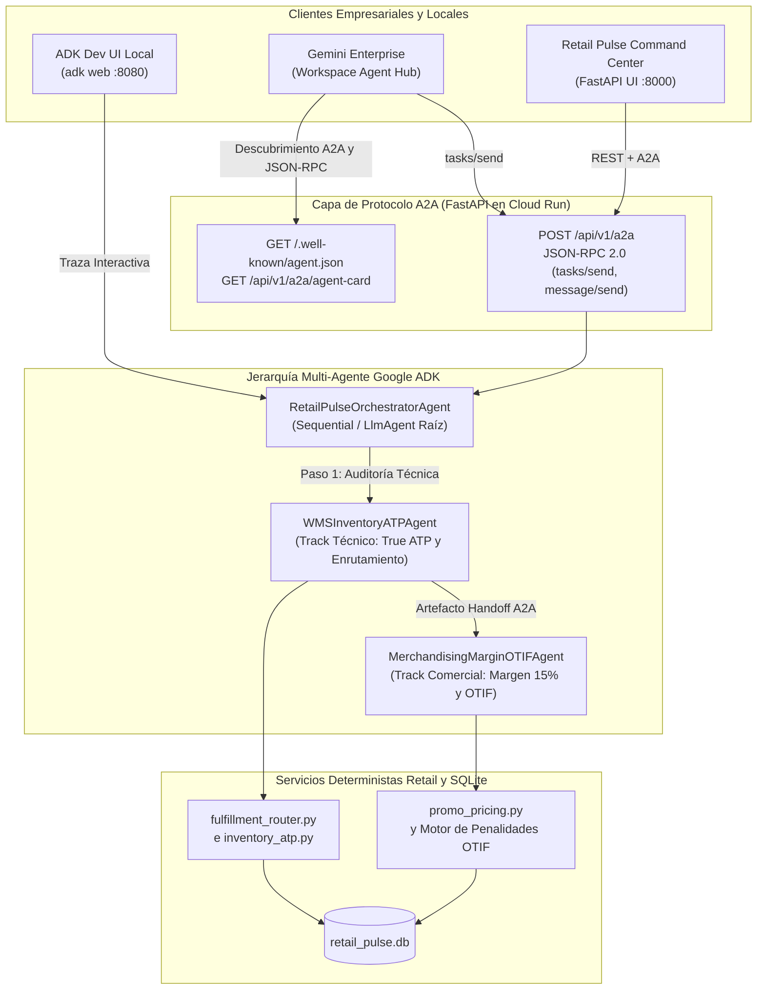

<p align="center">
  
</p>

# Lab 04: Capstone Multi-Agente — Google ADK, Protocolo A2A, Enrutamiento Omnicanal y Despliegue en Gemini Enterprise

**Duración**: 45 Minutos | **Perfil**: Track Técnico y Comercial | **Prerrequisitos**: Labs 01, 02 y 03 Completados

---

## 1. Escenario Retail y Contexto de Negocio

En los Labs 01–03, tu equipo estabilizó los pisos de margen promocional del 15%, reparó el cálculo de inventario True ATP, codificó los estándares de cumplimiento retail (`GEMINI.md`, `.agents/rules/retail-standards.md`, `.agents/skills/retail-otif-margin-auditor/SKILL.md`), y conectó Antigravity a `retail_pulse.db` mediante FastMCP y hooks deterministas `PreToolUse`.

Sin embargo, persisten dos desafíos operativos clave:
1. **35 órdenes VIP (niveles de lealtad `DIAMOND` y `GOLD`)** que representan **más de $250,000 en Customer Lifetime Value (LTV)** siguen bloqueadas en estado `AT_RISK_STOCKOUT` porque su tienda insignia original no tenía suficiente inventario True ATP.
2. Las operaciones retail empresariales requieren **agentes de IA especializados** — un **Agente Técnico WMS/POS de Inventario** y un **Agente Comercial de Merchandising, Margen y OTIF** — que se coordinen mediante **Google ADK (Agent Development Kit)**, expongan un endpoint abierto bajo el protocolo **A2A (Agent2Agent Protocol)** (`/.well-known/agent.json` y `POST /api/v1/a2a`), puedan probarse localmente en la interfaz **ADK Web UI (`adk web`)**, y se desplieguen en **Google Cloud Run + Gemini Enterprise** usando **Terraform**.

---

## 2. Objetivos de Aprendizaje

En este laboratorio capstone:
1. Usarás `/plan`, `/boost` y `/teamwork` para implementar `evaluate_candidates` y `optimize_at_risk_orders` en `src/services/fulfillment_router.py`, re-enrutando las 35 órdenes VIP `AT_RISK_STOCKOUT` a `REROUTED_OPTIMAL` y preservando `$14,774.00` en margen neto post-envío.
2. Diseñarás e implementarás un **Sistema Multi-Agente con Google ADK y el Protocolo A2A** en `src/agents/adk_a2a_orchestrator.py`:
   - `WMSInventoryATPAgent` (`wms_inventory_agent`): Agente técnico WMS/POS que audita el True ATP y ejecuta el re-enrutamiento óptimo omnicanal.
   - `MerchandisingMarginOTIFAgent` (`merchandising_margin_agent`): Agente comercial de Merchandising y Cumplimiento de Proveedores que aplica el piso de margen bruto del 15% y reclama `$98,250.00` en penalidades OTIF.
   - `RetailPulseOrchestratorAgent`: Orquestador raíz que coordina los handoffs A2A entre el agente técnico WMS y el agente comercial de Merchandising.
   - **A2A Discovery Card** (`GET /.well-known/agent.json` y `GET /api/v1/a2a/agent-card`) y **Endpoint A2A JSON-RPC 2.0** (`POST /api/v1/a2a` y `POST /api/v1/a2a/tasks/send` soportando `tasks/send` y `message/send`).
3. Probarás la jerarquía multi-agente interactivamente en tu máquina local usando **ADK Development UI (`adk web`)** mediante `./scripts/run_adk_web.sh` (`adk_agents/retail_pulse/agent.py`).
4. Aprovisionarás infraestructura en **Google Cloud Run + Vertex AI + Gemini Enterprise** con **Terraform** (`infra/terraform/`) y desplegarás/registrarás el agente A2A mediante `./labs/lab-04-multi-agent-capstone/deploy_gcp.sh` y `./deploy/register_gemini_enterprise_agent.sh`.

---

## 3. Diagrama de Arquitectura: ADK + A2A + Cloud Run + Gemini Enterprise



---

## 4. Instrucciones Paso a Paso

### Paso 1: Inicializar el Estado Inicial del Lab 04

Ejecuta el instalador del Lab 04 para aplicar automáticamente las soluciones de los Labs 01, 02 y 03 y cargar las plantillas iniciales del Lab 04 (`src/services/fulfillment_router.py` y `src/agents/adk_a2a_orchestrator.py`):

```bash
./labs/lab-04-multi-agent-capstone/install.sh
```

Ejecuta el script de verificación para observar las pruebas pendientes del Lab 04 (`NotImplementedError` en `fulfillment_router.py` y `adk_a2a_orchestrator.py`):

```bash
./labs/lab-04-multi-agent-capstone/verify.sh
```

---

### Paso 2: Implementar el Motor de Enrutamiento Omnicanal (`src/services/fulfillment_router.py`)

Abre `src/services/fulfillment_router.py` e implementa:
1. **`evaluate_candidates(conn, sku, qty, effective_unit_price_usd)`**:
   - Consulta `wms_inventory` para todos los nodos que tengan el `sku`.
   - Calcula `true_atp` usando `calculate_node_atp(dict(row))` de `src.services.inventory_atp`.
   - Filtra los nodos elegibles donde `true_atp >= qty`.
   - Calcula `shipping_cost_usd = round(float(row["shipping_zone_cost_usd"]), 2)`, `gross_margin_usd = (effective_unit_price_usd - unit_cost_usd) * qty`, y `post_shipping_net_margin_usd = round(gross_margin_usd - shipping_cost_usd, 2)`.
   - Ordena los candidatos elegibles por `(-c["post_shipping_net_margin_usd"], c["shipping_cost_usd"], 0 if c["location_type"] == "DC" else 1)`.
2. **`optimize_at_risk_orders(conn, dry_run=False)`**:
   - Consulta `omnichannel_orders` donde `status = 'AT_RISK_STOCKOUT'` ordenadas por `customer_ltv_usd DESC, order_id ASC`.
   - Re-enruta cada orden a `candidates[0]` (`status = 'REROUTED_OPTIMAL'`) y descuenta `on_hand_qty` en `wms_inventory` cuando `not dry_run`.

---

### Paso 3: Implementar el Orquestador Multi-Agente Google ADK y A2A (`src/agents/adk_a2a_orchestrator.py`)

Abre `src/agents/adk_a2a_orchestrator.py` y revisa cómo el sistema multi-agente conecta los perfiles **Técnico** y **Comercial**:
1. **`WMSInventoryATPAgent.execute(conn, dry_run)`**:
   - Ejecuta `audit_vip_oversell_risk(conn)` y `optimize_at_risk_orders(conn, dry_run=dry_run)`.
   - Emite un `A2AAgentHandoff` desde `wms_inventory_agent` hacia `merchandising_margin_agent` con el conteo de órdenes re-enrutadas, el LTV VIP protegido y el margen neto post-envío preservado.
2. **`MerchandisingMarginOTIFAgent.execute(conn, wms_handoff, dry_run)`**:
   - Recibe el artefacto de handoff del WMS, ejecuta `audit_margin_hold_orders(conn)` (aplicando el piso de margen bruto del 15%) y evalúa los contratos en incumplimiento en `vendor_otif_contracts` (`actual_otif_pct < contracted_otif_pct`) para calcular la recuperación de `$98,250.00` en penalidades.
3. **`RetailPulseOrchestratorAgent.run_orchestration(conn, prompt, dry_run, session_id)`**:
   - Coordina `WMSInventoryATPAgent` -> `MerchandisingMarginOTIFAgent`, construye la jerarquía Google ADK (`build_adk_agent_hierarchy()` usando `google.adk.agents.LlmAgent` y `SequentialAgent`), y devuelve el payload unificado de tarea A2A.
4. **Endpoints del Protocolo A2A (`build_a2a_agent_card` y `handle_a2a_jsonrpc`)**:
   - `GET /.well-known/agent.json` y `GET /api/v1/a2a/agent-card`: Devuelve la Agent Card A2A declarando las habilidades `retail_Margin_Floor_Enforcement`, `retail_True_ATP_Omnichannel_Routing` y `retail_Vendor_OTIF_Chargeback_Audit`.
   - `POST /api/v1/a2a` y `POST /api/v1/a2a/tasks/send`: Procesa peticiones JSON-RPC 2.0 `tasks/send` y `message/send` y retorna objetos A2A Task completados con `artifacts` (`wms_atp_routing_report`, `merchandising_margin_otif_report` y `a2a_handoff_trace`).

---

### Paso 4: Probar Localmente con ADK Development UI (`adk web`)

Google ADK incluye una interfaz web interactiva (`adk web`) para inspeccionar llamadas a herramientas, transferencias entre sub-agentes y el estado de sesión localmente antes de desplegar en Cloud Run.

1. Verifica la configuración de ADK Web en modo dry-run:
   ```bash
   ./scripts/run_adk_web.sh --dry-run
   ```
2. Inicia la interfaz interactiva ADK Development UI en el puerto `8080`:
   ```bash
   ./scripts/run_adk_web.sh --port 8080
   ```
3. Abre `http://127.0.0.1:8080` en tu navegador (o mediante `/browser`), selecciona el agente **`retail_pulse`** en el menú superior izquierdo y prueba prompts como:
   - *"Run a dry-run omnichannel triage across WMS True ATP routing, 15% promotional margin floors, and vendor OTIF chargebacks."*
   - *"Check the True ATP across all nodes for SKU-1001 and explain the VIP oversell risk."*
   - *"Execute live omnichannel remediation: enforce the 15% margin floor, reroute all 35 VIP orders, and claim OTIF vendor chargebacks."*

---

### Paso 5: Desplegar en Google Cloud Run con Terraform y Registrar en Gemini Enterprise

El repositorio incluye **Infraestructura como Código con Terraform** (`infra/terraform/`), un `Dockerfile` multi-etapa para Cloud Run y scripts de despliegue (`deploy/deploy_gcp.sh` y `deploy/register_gemini_enterprise_agent.sh`).

1. **Prueba el pipeline de Cloud Run + Terraform + Gemini Enterprise en modo `--dry-run`** (no requiere credenciales de GCP):
   ```bash
   ./labs/lab-04-multi-agent-capstone/deploy_gcp.sh --dry-run --project-id mi-proyecto-retail-gcp --region us-central1 --gemini-app-id retail-pulse-enterprise-app
   ```
2. **Despliega en vivo en Google Cloud Platform** (autenticado con `gcloud auth login`):
   ```bash
   ./labs/lab-04-multi-agent-capstone/deploy_gcp.sh --project-id TU_GCP_PROJECT_ID --region us-central1 --gemini-app-id TU_GEMINI_ENTERPRISE_APP_ID
   ```
   Este script automáticamente:
   - Construye y publica la imagen del contenedor en **Artifact Registry** mediante **Cloud Build**
   - Ejecuta `terraform init && terraform apply` en `infra/terraform/` para aprovisionar el servicio **Cloud Run v2** (`retail-pulse-a2a-service`), la cuenta de servicio IAM de mínimo privilegio, permisos de Vertex AI y variables de entorno (`GOOGLE_GENAI_USE_VERTEXAI=TRUE`)
   - Registra el Agente A2A desplegado en Cloud Run (`https://<cloud-run-url>/.well-known/agent.json` y `/api/v1/a2a`) en **Gemini Enterprise (Discovery Engine Agent Registry)** mediante `deploy/register_gemini_enterprise_agent.sh`.

---

## 5. Lista de Verificación

Ejecuta el script de verificación completo del capstone (que corre las **20 pruebas automatizadas** de los Labs 01–04):

```bash
./labs/lab-04-multi-agent-capstone/verify.sh
```

- [ ] `./labs/lab-04-multi-agent-capstone/verify.sh` aprueba las **20/20 pruebas automatizadas** en `test_lab01_triage.py`, `test_lab02_rules_skills.py`, `test_lab03_mcp_hooks.py` y `test_lab04_capstone.py`.
- [ ] Las 35 órdenes VIP en `AT_RISK_STOCKOUT` pasan a `REROUTED_OPTIMAL` con `$14,774.00` de margen neto total post-envío.
- [ ] `GET /.well-known/agent.json` devuelve una Agent Card A2A válida y `POST /api/v1/a2a` ejecuta el handoff multi-agente ADK (`wms_inventory_agent -> merchandising_margin_agent`).
- [ ] `./scripts/run_adk_web.sh --dry-run` y `./labs/lab-04-multi-agent-capstone/deploy_gcp.sh --dry-run` finalizan exitosamente.

> ¿Necesitas aplicar directamente la solución verificada del capstone? Ejecuta `./labs/lab-04-multi-agent-capstone/apply_solution.sh`.
