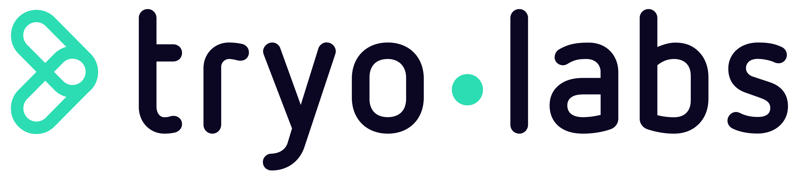
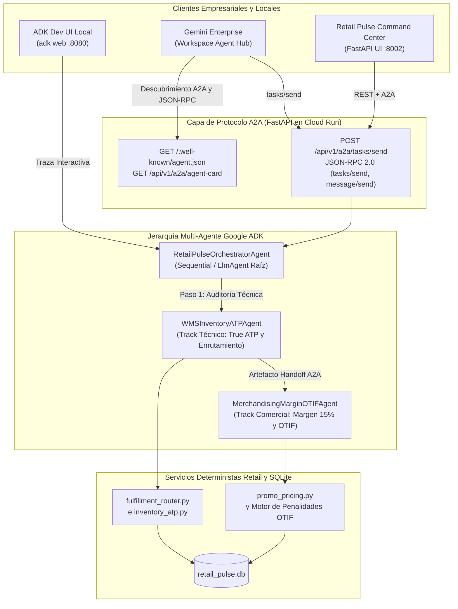

<p align="center">
  
</p>

# Lab 04: Capstone Multi-Agente — Google ADK, Protocolo A2A, Enrutamiento Omnicanal y Despliegue en Gemini Enterprise

**Duración**: 45 Minutos | **Perfil**: Track Técnico y Comercial | **Prerrequisitos**: Labs 01, 02 y 03 Completados

> **Idioma / Language:** [Español](./README.es.md) | [English](./README.md) • **Guía de Prompts:** [PROMPTS.es.md](./PROMPTS.es.md) | [PROMPTS.md](./PROMPTS.md) • **PDF:** [ES](./LAB_04_INSTRUCTIONS_ES.pdf) | [EN](./LAB_04_INSTRUCTIONS_EN.pdf)

---

## 1. Escenario Retail y Contexto de Negocio

En los Labs 01–03, tu equipo estabilizó los pisos de margen promocional del 15%, reparó el cálculo de inventario True ATP, codificó los estándares de cumplimiento retail (`GEMINI.md`, `.agents/rules/retail-standards.md`, `.agents/skills/retail-otif-margin-auditor/SKILL.md`), y conectó Antigravity a `retail_pulse.db` mediante FastMCP y hooks deterministas `PreToolUse`.

Sin embargo, persisten dos desafíos operativos clave:
1. **35 órdenes VIP (niveles de lealtad `DIAMOND` y `GOLD`)** que representan **$749,300.00 en Customer Lifetime Value (LTV)** siguen bloqueadas en estado `AT_RISK_STOCKOUT` porque su tienda insignia original no tenía suficiente inventario True ATP.
2. Las operaciones retail empresariales requieren **agentes de IA especializados** — un **Agente Técnico WMS/POS de Inventario** y un **Agente Comercial de Merchandising, Margen y OTIF** — que se coordinen mediante **Google ADK (Agent Development Kit)**, expongan un endpoint abierto bajo el protocolo **A2A (Agent2Agent Protocol)** (`/.well-known/agent.json` y `POST /api/v1/a2a/tasks/send`), puedan probarse localmente en la interfaz **ADK Web UI (`adk web`)**, y se desplieguen en **Google Cloud Run + Gemini Enterprise** usando **Terraform**.

---

## 2. Objetivos de Aprendizaje

En este laboratorio capstone:
1. Usarás `/plan`, `/boost` y `/teamwork` para implementar `optimize_at_risk_order_routing` y `claim_vendor_otif_chargebacks` en `src/services/fulfillment_router.py`:
   - `optimize_at_risk_order_routing`: Re-enruta las 35 órdenes VIP `AT_RISK_STOCKOUT` al nodo de cumplimiento con mayor margen neto post-envío y `true_atp >= qty` (priorizando Centros de Distribución `DC` sobre tiendas `STORE` en caso de empate), cambiando su estado a `REROUTED_SAVED` y protegiendo **`$749,300.00`** en LTV VIP.
   - `claim_vendor_otif_chargebacks`: Audita los contratos de proveedores en incumplimiento y actualiza los 6 contratos (`actual_otif_pct < contracted_otif_pct`) a `CHARGEBACK_CLAIMED`, recuperando **`$98,250.00`** en notas de débito contractuales.
2. Diseñarás e implementarás un **Sistema Multi-Agente con Google ADK y el Protocolo A2A** en `src/agents/adk_a2a_orchestrator.py`:
   - `WMSInventoryATPAgent` (`wms_inventory_atp_agent`): Agente técnico WMS/POS que audita el True ATP y ejecuta el re-enrutamiento óptimo omnicanal.
   - `MerchandisingMarginOTIFAgent` (`merchandising_margin_otif_agent`): Agente comercial de Merchandising y Cumplimiento de Proveedores que aplica el piso de margen bruto del 15% y reclama `$98,250.00` en penalidades OTIF.
   - `RetailPulseOrchestratorAgent`: Orquestador raíz (`run_multi_agent_workflow`) que coordina los handoffs A2A entre el agente técnico WMS y el agente comercial de Merchandising.
   - **A2A Discovery Card** (`get_a2a_agent_card` para `GET /.well-known/agent.json` y `GET /api/v1/a2a/agent-card`) y **Endpoint A2A JSON-RPC 2.0** (`handle_a2a_jsonrpc` para `POST /api/v1/a2a` y `POST /api/v1/a2a/tasks/send` soportando `tasks/send`, `message/send` y `tasks/get`).
3. Probarás la jerarquía multi-agente interactivamente en tu máquina local usando **ADK Development UI (`adk web`)** mediante `./scripts/run_adk_web.sh` (`adk_agents/retail_pulse/agent.py`).
4. Validarás la infraestructura de **Google Cloud Run + Vertex AI + Gemini Enterprise** con **Terraform** (`infra/terraform/`) y `./labs/lab-04-multi-agent-capstone/deploy_gcp.sh --dry-run`.

---

## 3. Diagrama de Arquitectura: ADK + A2A + Cloud Run + Gemini Enterprise



---

## 4. Instrucciones Paso a Paso

### Paso 1: Inicializar el Estado Inicial del Lab 04

Ejecuta el instalador del Lab 04 para aplicar automáticamente las soluciones de los Labs 01, 02 y 03 y cargar las plantillas iniciales del Lab 04 (`src/services/fulfillment_router.py` y `src/agents/adk_a2a_orchestrator.py`):

```bash
./labs/lab-04-multi-agent-capstone/install.sh
```

Ejecuta el script de verificación para observar las pruebas pendientes del Lab 04 (`NotImplementedError` en `fulfillment_router.py` y `adk_a2a_orchestrator.py`):

```bash
./labs/lab-04-multi-agent-capstone/verify.sh
```

---

### Paso 2: Implementar el Motor de Enrutamiento Omnicanal y Penalidades OTIF (`src/services/fulfillment_router.py`)

Abre `src/services/fulfillment_router.py` e implementa:
1. **`optimize_at_risk_order_routing(loyalty_tiers=("DIAMOND", "GOLD"), persist_changes=True, db_path=None) -> dict[str, Any]`**:
   - Consulta `omnichannel_orders` unido con `sku_catalog` para órdenes en `loyalty_tiers` ordenadas por `customer_ltv_usd DESC, order_id ASC`.
   - Identifica las órdenes donde `status == "AT_RISK_STOCKOUT"` o donde `evaluate_location_atp(..., required_qty=qty)["oversell_risk"]` en el nodo actual sea `True`.
   - Busca ubicaciones candidatas en `wms_inventory` para el SKU donde `evaluate_location_atp(..., required_qty=qty)["can_fulfill"]` sea `True`.
   - Calcula `shipping_cost = float(loc["shipping_zone_cost_usd"]) * qty`, `post_shipping_margin_usd = round((unit_price - unit_cost) * qty - shipping_cost, 2)` y `post_shipping_margin_pct`, ordenando los candidatos por `(-c["post_shipping_margin_usd"], 0 if c["location_type"] == "DC" else 1, -c["true_atp"])`.
   - Cuando `persist_changes=True`, actualiza `omnichannel_orders` (`assigned_location_id = best["location_id"]`, `shipping_cost_usd = best["shipping_cost_usd"]`, `status = "REROUTED_SAVED"`).
   - Devuelve `at_risk_orders_evaluated`, `rerouted_orders_count` (`35`), `vip_ltv_protected_usd` (`749300.0`), `post_shipping_margin_saved_usd` y `rerouted_orders`.
2. **`claim_vendor_otif_chargebacks(min_shortfall_pct=0.01, db_path=None) -> dict[str, Any]`**:
   - Llama a `audit_all_vendor_otif_contracts(only_breaching=True, db_path=db_path)`, filtra contratos con `shortfall_pct >= min_shortfall_pct`, actualiza `vendor_otif_contracts` (`status = 'CHARGEBACK_CLAIMED'`) y devuelve `contracts_claimed_count` (`6`), `total_chargeback_claimed_usd` (`98250.0`) y `claimed_contracts`.

---

### Paso 3: Implementar el Orquestador Multi-Agente Google ADK y A2A (`src/agents/adk_a2a_orchestrator.py`)

Abre `src/agents/adk_a2a_orchestrator.py` y revisa cómo el sistema multi-agente conecta los perfiles **Técnico** y **Comercial**:
1. **`WMSInventoryATPAgent.execute(task_payload)`**:
   - Ejecuta `optimize_at_risk_order_routing(...)` y `get_inventory_atp_summary(...)`, devolviendo `agent_id`, `role`, `atp_network_summary`, `routing_optimization` y `handoff_recommendation`.
2. **`MerchandisingMarginOTIFAgent.execute(task_payload, wms_routing_output=None)`**:
   - Consume el resultado del enrutamiento WMS, ejecuta `remediate_margin_floor_violations(...)` (aplicando el piso de margen bruto del 15% en las 28 órdenes `MARGIN_HOLD`) y ejecuta `claim_vendor_otif_chargebacks(...)` (recuperando `$98,250.00` en 6 proveedores en incumplimiento).
3. **`RetailPulseOrchestratorAgent.run_multi_agent_workflow(prompt, skill_id=None, metadata=None)`**:
   - Coordina `WMSInventoryATPAgent` -> `MerchandisingMarginOTIFAgent` mediante `a2a_handoffs`, construye los metadatos de Google ADK (`adk_runtime`) y devuelve el impacto financiero combinado (`vip_ltv_protected_usd = 749300.0`, `otif_chargebacks_claimed_usd = 98250.0`, `margin_recovered_usd = 18420.5`).
4. **Funciones del Protocolo A2A (`get_a2a_agent_card` y `handle_a2a_jsonrpc`)**:
   - `GET /.well-known/agent.json` y `GET /api/v1/a2a/agent-card`: Devuelve la Agent Card A2A (`protocolVersion: "0.2.1"`) declarando las habilidades `wms_atp_rerouting`, `promo_margin_guard_audit` y `vendor_otif_chargeback_recovery`.
   - `POST /api/v1/a2a` y `POST /api/v1/a2a/tasks/send`: Procesa peticiones JSON-RPC 2.0 `tasks/send`, `message/send` y `tasks/get` y retorna objetos A2A Task completados con `artifacts`.

---

### Paso 4: Probar Localmente con ADK Development UI (`adk web`) y el Command Center FastAPI

Google ADK incluye una interfaz web interactiva (`adk web`) para inspeccionar llamadas a herramientas, transferencias entre sub-agentes y el estado de sesión localmente antes de desplegar en Cloud Run.

1. Verifica la configuración de ADK Web en modo check/dry-run:
   ```bash
   ./scripts/run_adk_web.sh --check
   ```
2. Inicia la interfaz interactiva ADK Development UI en el puerto `8080`:
   ```bash
   ./scripts/run_adk_web.sh --port 8080
   ```
3. Abre `http://127.0.0.1:8080` en tu navegador (o mediante `/browser`), selecciona el agente **`retail_pulse`** en el menú superior izquierdo y prueba prompts como:
   - *"Ejecuta un triaje omnicanal completo abarcando el enrutamiento True ATP en WMS, los pisos de margen promocional del 15% y los chargebacks OTIF de proveedores."*
   - *"Consulta el True ATP en todos los nodos para SKU-OLED-65 y explica el riesgo de sobreventa VIP."*
4. Inicia el **Retail Pulse FastAPI Command Center** en el puerto `8002`:
   ```bash
   ./.venv/bin/uvicorn src.main:app --host 127.0.0.1 --port 8002
   ```
   Abre `http://localhost:8002` y `http://localhost:8002/.well-known/agent.json` para inspeccionar el dashboard en vivo y la Agent Card A2A.

---

### Paso 5: Validar el Pipeline de Despliegue en Google Cloud Run + Terraform + Gemini Enterprise

El repositorio incluye **Infraestructura como Código con Terraform** (`infra/terraform/`), un `Dockerfile` multi-etapa para Cloud Run y scripts de despliegue (`deploy/deploy_gcp.sh` y `deploy/register_gemini_enterprise_agent.sh`).

1. **Prueba el pipeline de Cloud Run + Terraform + Gemini Enterprise en modo `--dry-run`** (no requiere credenciales de GCP):
   ```bash
   ./labs/lab-04-multi-agent-capstone/deploy_gcp.sh --dry-run --project-id mi-proyecto-retail-gcp --region us-central1 --gemini-app-id retail-pulse-enterprise-app
   ```
2. **Opcional — Despliega en vivo en Google Cloud Platform** (autenticado con `gcloud auth login`):
   ```bash
   ./labs/lab-04-multi-agent-capstone/deploy_gcp.sh --project-id TU_GCP_PROJECT_ID --region us-central1 --gemini-app-id TU_GEMINI_ENTERPRISE_APP_ID
   ```

---

## 5. Lista de Verificación

Ejecuta el script de verificación completo del capstone (que corre las **20 pruebas automatizadas** de los Labs 01–04):

```bash
./labs/lab-04-multi-agent-capstone/verify.sh
```

- [ ] `./labs/lab-04-multi-agent-capstone/verify.sh` aprueba las **20/20 pruebas automatizadas** en `test_lab01_triage.py` (6), `test_lab02_rules_skills.py` (4), `test_lab03_mcp_hooks.py` (3) y `test_lab04_capstone.py` (7).
- [ ] Las 35 órdenes VIP en `AT_RISK_STOCKOUT` pasan a `REROUTED_SAVED` protegiendo **`$749,300.00`** en LTV VIP, y los 6 contratos de proveedores en incumplimiento pasan a `CHARGEBACK_CLAIMED` recuperando **`$98,250.00`**.
- [ ] `GET /.well-known/agent.json` devuelve una Agent Card A2A válida y `POST /api/v1/a2a/tasks/send` ejecuta el handoff multi-agente ADK (`wms_inventory_atp_agent -> merchandising_margin_otif_agent`).
- [ ] `./scripts/run_adk_web.sh --check` y `./labs/lab-04-multi-agent-capstone/deploy_gcp.sh --dry-run` finalizan exitosamente.

> ¿Necesitas aplicar directamente la solución verificada del capstone? Ejecuta `./labs/lab-04-multi-agent-capstone/apply_solution.sh`.
