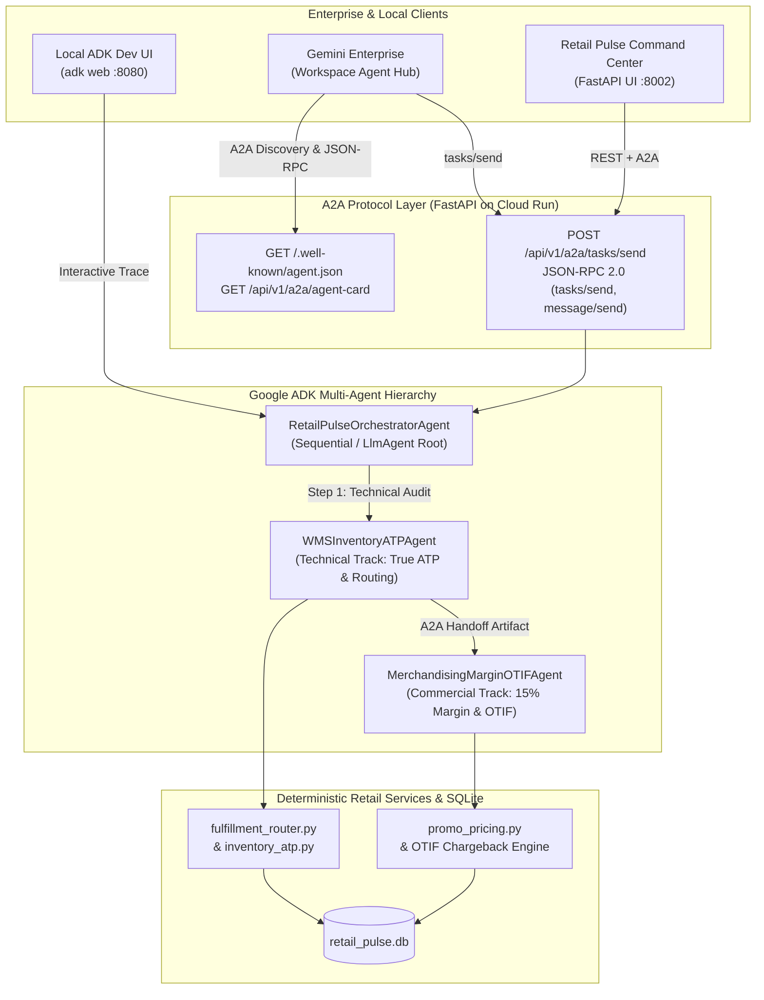

<p align="center">
  
</p>

# Lab 04: Multi-Agent Capstone — Google ADK, A2A Protocol, Omnichannel Routing & Gemini Enterprise Deployment

**Duration**: 45 Minutes | **Persona**: Technical & Commercial Track | **Prerequisites**: Labs 01, 02 & 03 Completed

---

## 1. Retail Scenario & Business Context

In Labs 01–03, your team stabilized promotional margin floors, repaired True ATP inventory calculations, encoded retail compliance standards (`GEMINI.md`, `.agents/rules/retail-standards.md`, `.agents/skills/retail-otif-margin-auditor/SKILL.md`), and connected Antigravity to `retail_pulse.db` via FastMCP and deterministic `PreToolUse` hooks.

However, two major operational challenges remain:
1. **35 VIP orders (`DIAMOND` and `GOLD` loyalty tiers)** representing **$749,300.00 in Customer Lifetime Value (LTV)** are still stuck in `AT_RISK_STOCKOUT` status because their original flagship store node lacked sufficient True ATP inventory.
2. Enterprise retail operations require **specialist AI agents** — a **Technical WMS/POS Inventory Agent** and a **Commercial Merchandising Margin & OTIF Agent** — that coordinate via **Google ADK (Agent Development Kit)**, expose an open **A2A (Agent2Agent Protocol)** endpoint (`/.well-known/agent.json` and `POST /api/v1/a2a/tasks/send`), can be inspected locally in the **ADK Web UI (`adk web`)**, and deploy to **Google Cloud Run + Gemini Enterprise** via **Terraform**.

---

## 2. Learning Objectives

In this capstone lab, you will:
1. Use `/plan`, `/boost`, and `/teamwork` to implement `optimize_at_risk_order_routing` and `claim_vendor_otif_chargebacks` in `src/services/fulfillment_router.py`:
   - `optimize_at_risk_order_routing`: Reroutes all 35 `AT_RISK_STOCKOUT` VIP orders to the highest post-shipping net margin fulfillment node with `true_atp >= qty` (preferring Distribution Centers `DC` over `STORE` nodes on ties), transitioning orders to `REROUTED_SAVED` and protecting **`$749,300.00`** in VIP Customer LTV.
   - `claim_vendor_otif_chargebacks`: Audits breaching supplier contracts and transitions all 6 breaching contracts (`actual_otif_pct < contracted_otif_pct`) to `CHARGEBACK_CLAIMED`, recovering **`$98,250.00`** in contractual debit memos.
2. Design and implement a **Multi-Agent System with Google ADK & A2A Protocol** in `src/agents/adk_a2a_orchestrator.py`:
   - `WMSInventoryATPAgent` (`wms_inventory_atp_agent`): Technical WMS/POS agent auditing True ATP and executing optimal split-shipment rerouting.
   - `MerchandisingMarginOTIFAgent` (`merchandising_margin_otif_agent`): Commercial Merchandising & Vendor Compliance agent enforcing the 15% gross margin floor and claiming `$98,250.00` in OTIF chargebacks.
   - `RetailPulseOrchestratorAgent`: Root orchestrator (`run_multi_agent_workflow`) coordinating A2A handoffs between the Technical WMS agent and the Commercial Merchandising agent.
   - Standard **A2A Discovery Card** (`get_a2a_agent_card` backing `GET /.well-known/agent.json` & `GET /api/v1/a2a/agent-card`) and **A2A JSON-RPC 2.0 Task Endpoint** (`handle_a2a_jsonrpc` backing `POST /api/v1/a2a` & `POST /api/v1/a2a/tasks/send` supporting `tasks/send`, `message/send`, and `tasks/get`).
3. Test the multi-agent hierarchy interactively on your laptop using the **ADK Development UI (`adk web`)** via `./scripts/run_adk_web.sh` (`adk_agents/retail_pulse/agent.py`).
4. Validate **Google Cloud Run + Vertex AI + Gemini Enterprise** infrastructure using **Terraform** (`infra/terraform/`) and `./labs/lab-04-multi-agent-capstone/deploy_gcp.sh --dry-run`.

---

## 3. Architecture Diagram: ADK + A2A + Cloud Run + Gemini Enterprise



---

## 4. Step-by-Step Instructions

### Step 1: Initialize the Lab 04 Starter State

Run the Lab 04 installer to ensure Labs 01, 02, and 03 solutions are applied and load the Lab 04 starter stubs (`src/services/fulfillment_router.py` and `src/agents/adk_a2a_orchestrator.py`):

```bash
./labs/lab-04-multi-agent-capstone/install.sh
```

Run the verification script to observe the failing Lab 04 capstone tests (`NotImplementedError` in `fulfillment_router.py` and `adk_a2a_orchestrator.py`):

```bash
./labs/lab-04-multi-agent-capstone/verify.sh
```

---

### Step 2: Implement Smart Split-Shipment Routing & OTIF Chargebacks (`src/services/fulfillment_router.py`)

Open `src/services/fulfillment_router.py` and implement:
1. **`optimize_at_risk_order_routing(loyalty_tiers=("DIAMOND", "GOLD"), persist_changes=True, db_path=None) -> dict[str, Any]`**:
   - Query `omnichannel_orders` joined with `sku_catalog` for orders in `loyalty_tiers` ordered by `customer_ltv_usd DESC, order_id ASC`.
   - Identify orders where `status == "AT_RISK_STOCKOUT"` or the current node's `evaluate_location_atp(..., required_qty=qty)["oversell_risk"]` is `True`.
   - Find candidate locations in `wms_inventory` for the SKU where `evaluate_location_atp(..., required_qty=qty)["can_fulfill"]` is `True`.
   - Compute `shipping_cost = float(loc["shipping_zone_cost_usd"]) * qty`, `post_shipping_margin_usd = round((unit_price - unit_cost) * qty - shipping_cost, 2)`, and `post_shipping_margin_pct`, ranking candidates by `(-c["post_shipping_margin_usd"], 0 if c["location_type"] == "DC" else 1, -c["true_atp"])`.
   - When `persist_changes=True`, update `omnichannel_orders` (`assigned_location_id = best["location_id"]`, `shipping_cost_usd = best["shipping_cost_usd"]`, `status = "REROUTED_SAVED"`).
   - Return `at_risk_orders_evaluated`, `rerouted_orders_count` (`35`), `vip_ltv_protected_usd` (`749300.0`), `post_shipping_margin_saved_usd`, and `rerouted_orders`.
2. **`claim_vendor_otif_chargebacks(min_shortfall_pct=0.01, db_path=None) -> dict[str, Any]`**:
   - Call `audit_all_vendor_otif_contracts(only_breaching=True, db_path=db_path)`, filter to contracts with `shortfall_pct >= min_shortfall_pct`, update `vendor_otif_contracts` (`status = 'CHARGEBACK_CLAIMED'`), and return `contracts_claimed_count` (`6`), `total_chargeback_claimed_usd` (`98250.0`), and `claimed_contracts`.

---

### Step 3: Implement the Google ADK & A2A Multi-Agent Orchestrator (`src/agents/adk_a2a_orchestrator.py`)

Open `src/agents/adk_a2a_orchestrator.py` and review how the multi-agent system bridges the **Technical** and **Commercial** personas:
1. **`WMSInventoryATPAgent.execute(task_payload)`**:
   - Runs `optimize_at_risk_order_routing(...)` and `get_inventory_atp_summary(...)`, returning `agent_id`, `role`, `atp_network_summary`, `routing_optimization`, and `handoff_recommendation`.
2. **`MerchandisingMarginOTIFAgent.execute(task_payload, wms_routing_output=None)`**:
   - Consumes the WMS routing output, runs `remediate_margin_floor_violations(...)` (enforcing the 15% gross margin floor across all 28 `MARGIN_HOLD` orders), and runs `claim_vendor_otif_chargebacks(...)` (recovering `$98,250.00` across 6 breaching suppliers).
3. **`RetailPulseOrchestratorAgent.run_multi_agent_workflow(prompt, skill_id=None, metadata=None)`**:
   - Coordinates `WMSInventoryATPAgent` -> `MerchandisingMarginOTIFAgent` via explicit `a2a_handoffs`, builds the Google ADK runtime metadata (`adk_runtime`), and returns the combined financial impact (`vip_ltv_protected_usd = 749300.0`, `otif_chargebacks_claimed_usd = 98250.0`, `margin_recovered_usd = 18420.5`).
4. **A2A Protocol Functions (`get_a2a_agent_card` & `handle_a2a_jsonrpc`)**:
   - `GET /.well-known/agent.json` and `GET /api/v1/a2a/agent-card`: Returns the A2A Agent Card (`protocolVersion: "0.2.1"`) declaring `wms_atp_rerouting`, `promo_margin_guard_audit`, and `vendor_otif_chargeback_recovery` skills.
   - `POST /api/v1/a2a` and `POST /api/v1/a2a/tasks/send`: Processes A2A JSON-RPC 2.0 `tasks/send`, `message/send`, and `tasks/get` requests and returns completed A2A Task objects with `artifacts`.

---

### Step 4: Test Locally with the ADK Development UI (`adk web`) & FastAPI Command Center

Google ADK includes a built-in interactive web UI (`adk web`) for inspecting multi-agent tool calls, sub-agent transfers, and session state locally before deploying to Cloud Run.

1. Verify the ADK Web configuration in check/dry-run mode:
   ```bash
   ./scripts/run_adk_web.sh --check
   ```
2. Launch the interactive ADK Development UI on port `8080`:
   ```bash
   ./scripts/run_adk_web.sh --port 8080
   ```
3. Open `http://127.0.0.1:8080` in your browser (or via `/browser`), select the **`retail_pulse`** agent from the top-left dropdown, and test prompts such as:
   - *"Run a full omnichannel triage across WMS True ATP routing, 15% promotional margin floors, and vendor OTIF chargebacks."*
   - *"Check the True ATP across all nodes for SKU-OLED-65 and explain the VIP oversell risk."*
4. Launch the **Retail Pulse FastAPI Command Center** on port `8002`:
   ```bash
   ./.venv/bin/uvicorn src.main:app --host 127.0.0.1 --port 8002
   ```
   Open `http://localhost:8002` and `http://localhost:8002/.well-known/agent.json` to inspect the live dashboard and A2A Agent Card.

---

### Step 5: Validate Google Cloud Run + Terraform + Gemini Enterprise Deployment Pipeline

The repository includes production-ready **Terraform Infrastructure-as-Code** (`infra/terraform/`), a multi-stage Cloud Run `Dockerfile`, and deployment scripts (`deploy/deploy_gcp.sh` and `deploy/register_gemini_enterprise_agent.sh`).

1. **Test the Cloud Run + Terraform + Gemini Enterprise pipeline in `--dry-run` mode** (no GCP credentials required):
   ```bash
   ./labs/lab-04-multi-agent-capstone/deploy_gcp.sh --dry-run --project-id my-retail-gcp-project --region us-central1 --gemini-app-id retail-pulse-enterprise-app
   ```
2. **Optional — Deploy live to Google Cloud Platform** (when authenticated with `gcloud auth login`):
   ```bash
   ./labs/lab-04-multi-agent-capstone/deploy_gcp.sh --project-id YOUR_GCP_PROJECT_ID --region us-central1 --gemini-app-id YOUR_GEMINI_ENTERPRISE_APP_ID
   ```

---

## 5. Verification Checklist

Run the full capstone verification script (which runs all **20 automated tests** across Labs 01–04):

```bash
./labs/lab-04-multi-agent-capstone/verify.sh
```

- [ ] `./labs/lab-04-multi-agent-capstone/verify.sh` passes all **20/20 automated tests** across `test_lab01_triage.py` (6), `test_lab02_rules_skills.py` (4), `test_lab03_mcp_hooks.py` (3), and `test_lab04_capstone.py` (7).
- [ ] All 35 VIP orders in `AT_RISK_STOCKOUT` are transitioned to `REROUTED_SAVED` protecting **`$749,300.00`** in VIP Customer LTV, and all 6 breaching vendor contracts transition to `CHARGEBACK_CLAIMED` recovering **`$98,250.00`**.
- [ ] `GET /.well-known/agent.json` returns a valid A2A Agent Card and `POST /api/v1/a2a/tasks/send` executes the multi-agent ADK handoff (`wms_inventory_atp_agent -> merchandising_margin_otif_agent`).
- [ ] `./scripts/run_adk_web.sh --check` and `./labs/lab-04-multi-agent-capstone/deploy_gcp.sh --dry-run` succeed cleanly.

> Need to apply the verified capstone solution directly? Run `./labs/lab-04-multi-agent-capstone/apply_solution.sh`.
