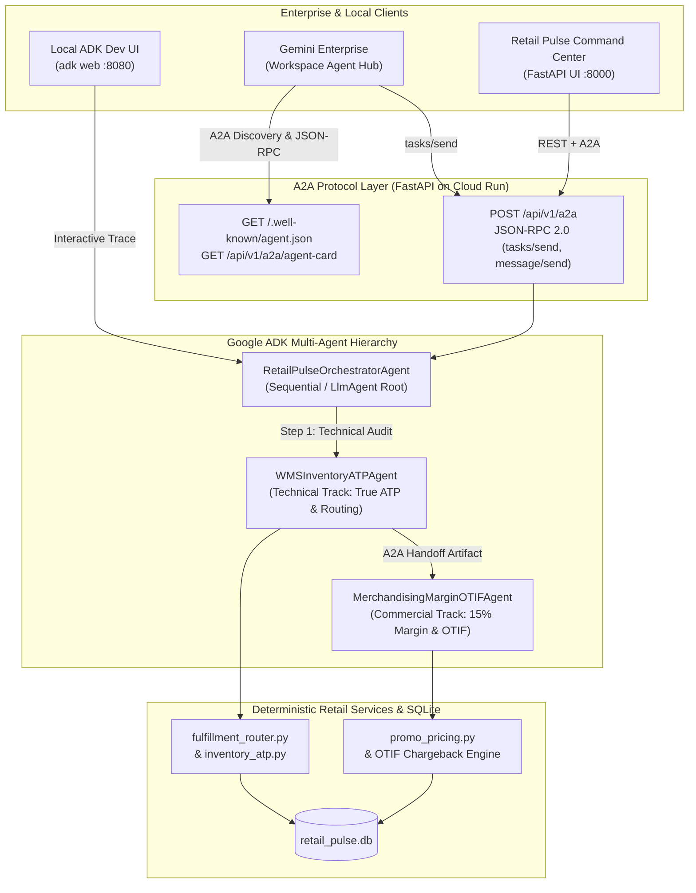

# Lab 04: Multi-Agent Capstone — Google ADK, A2A Protocol, Omnichannel Routing & Gemini Enterprise Deployment

**Duration**: 45 Minutes | **Persona**: Technical & Commercial Track | **Prerequisites**: Labs 01, 02 & 03 Completed

---

## 1. Retail Scenario & Business Context

In Labs 01–03, your team stabilized promotional margin floors, repaired True ATP inventory calculations, encoded retail compliance standards (`GEMINI.md`, `.agents/rules/retail-standards.md`, `.agents/skills/retail-otif-margin-auditor/SKILL.md`), and connected Antigravity to `retail_pulse.db` via FastMCP and deterministic `PreToolUse` hooks.

However, two major operational challenges remain:
1. **35 VIP orders (`DIAMOND` and `GOLD` loyalty tiers)** representing **over $250,000 in Customer Lifetime Value (LTV)** are still stuck in `AT_RISK_STOCKOUT` status because their original flagship store node lacked sufficient True ATP inventory.
2. Enterprise retail operations require **specialist AI agents** — a **Technical WMS/POS Inventory Agent** and a **Commercial Merchandising Margin & OTIF Agent** — that coordinate via **Google ADK (Agent Development Kit)**, expose an open **A2A (Agent2Agent Protocol)** endpoint (`/.well-known/agent.json` and `POST /api/v1/a2a`), can be inspected locally in the **ADK Web UI (`adk web`)**, and deploy to **Google Cloud Run + Gemini Enterprise** via **Terraform**.

---

## 2. Learning Objectives

In this capstone lab, you will:
1. Use `/plan`, `/boost`, and `/teamwork` to implement `evaluate_candidates` and `optimize_at_risk_orders` in `src/services/fulfillment_router.py`, rerouting all 35 `AT_RISK_STOCKOUT` VIP orders to `REROUTED_OPTIMAL` and preserving `$14,774.00` in post-shipping net margin.
2. Design and implement a **Multi-Agent System with Google ADK & A2A Protocol** in `src/agents/adk_a2a_orchestrator.py`:
   - `WMSInventoryATPAgent` (`wms_inventory_agent`): Technical WMS/POS agent auditing True ATP and executing optimal split-shipment rerouting.
   - `MerchandisingMarginOTIFAgent` (`merchandising_margin_agent`): Commercial Merchandising & Vendor Compliance agent enforcing the 15% gross margin floor and claiming `$98,250.00` in OTIF chargebacks.
   - `RetailPulseOrchestratorAgent`: Root orchestrator coordinating A2A handoffs between the Technical WMS agent and the Commercial Merchandising agent.
   - Standard **A2A Discovery Card** (`GET /.well-known/agent.json` & `GET /api/v1/a2a/agent-card`) and **A2A JSON-RPC 2.0 Task Endpoint** (`POST /api/v1/a2a` & `POST /api/v1/a2a/tasks/send` supporting `tasks/send` and `message/send`).
3. Test the multi-agent hierarchy interactively on your laptop using the **ADK Development UI (`adk web`)** via `./scripts/run_adk_web.sh` (`adk_agents/retail_pulse/agent.py`).
4. Provision **Google Cloud Run + Vertex AI + Gemini Enterprise** infrastructure using **Terraform** (`infra/terraform/`) and deploy/register the A2A agent via `./labs/lab-04-multi-agent-capstone/deploy_gcp.sh` and `./deploy/register_gemini_enterprise_agent.sh`.

---

## 3. Architecture Diagram: ADK + A2A + Cloud Run + Gemini Enterprise



---

## 4. Step-by-Step Instructions

### Step 1: Initialize the Lab 04 Starter State

Run the Lab 04 installer to ensure Labs 01, 02, and 03 solutions are applied and load the Lab 04 starter stubs (`src/services/fulfillment_router.py` and `src/agents/adk_a2a_orchestrator.py`):

```bash
./labs/lab-04-multi-agent-capstone/install.sh
```

Run the verification script to observe the failing Lab 04 capstone tests (`NotImplementedError` in `fulfillment_router.py` and `adk_a2a_orchestrator.py`):

```bash
./labs/lab-04-multi-agent-capstone/verify.sh
```

---

### Step 2: Implement Smart Split-Shipment Routing (`src/services/fulfillment_router.py`)

Open `src/services/fulfillment_router.py` and implement:
1. **`evaluate_candidates(conn, sku, qty, effective_unit_price_usd)`**:
   - Query `wms_inventory` for all nodes holding `sku`.
   - Compute `true_atp` using `calculate_node_atp(dict(row))` from `src.services.inventory_atp`.
   - Filter to eligible nodes where `true_atp >= qty`.
   - Compute `shipping_cost_usd = round(float(row["shipping_zone_cost_usd"]), 2)`, `gross_margin_usd = (effective_unit_price_usd - unit_cost_usd) * qty`, and `post_shipping_net_margin_usd = round(gross_margin_usd - shipping_cost_usd, 2)`.
   - Sort eligible candidates by `(-c["post_shipping_net_margin_usd"], c["shipping_cost_usd"], 0 if c["location_type"] == "DC" else 1)`.
2. **`optimize_at_risk_orders(conn, dry_run=False)`**:
   - Query `omnichannel_orders` where `status = 'AT_RISK_STOCKOUT'` ordered by `customer_ltv_usd DESC, order_id ASC`.
   - Reroute each order to `candidates[0]` (`status = 'REROUTED_OPTIMAL'`) and decrement `on_hand_qty` in `wms_inventory` when `not dry_run`.

---

### Step 3: Implement the Google ADK & A2A Multi-Agent Orchestrator (`src/agents/adk_a2a_orchestrator.py`)

Open `src/agents/adk_a2a_orchestrator.py` and review how the multi-agent system bridges the **Technical** and **Commercial** personas:
1. **`WMSInventoryATPAgent.execute(conn, dry_run)`**:
   - Runs `audit_vip_oversell_risk(conn)` and `optimize_at_risk_orders(conn, dry_run=dry_run)`.
   - Emits an `A2AAgentHandoff` from `wms_inventory_agent` to `merchandising_margin_agent` with the rerouted order count, VIP LTV protected, and preserved post-shipping net margin.
2. **`MerchandisingMarginOTIFAgent.execute(conn, wms_handoff, dry_run)`**:
   - Consumes the WMS handoff artifact, runs `audit_margin_hold_orders(conn)` (enforcing the 15% gross margin floor), and evaluates all breaching `vendor_otif_contracts` (`actual_otif_pct < contracted_otif_pct`) to compute the `$98,250.00` chargeback recovery.
3. **`RetailPulseOrchestratorAgent.run_orchestration(conn, prompt, dry_run, session_id)`**:
   - Coordinates `WMSInventoryATPAgent` -> `MerchandisingMarginOTIFAgent`, builds the Google ADK agent hierarchy (`build_adk_agent_hierarchy()` using `google.adk.agents.LlmAgent` and `SequentialAgent`), and returns the unified A2A task payload.
4. **A2A Protocol Endpoints (`build_a2a_agent_card` & `handle_a2a_jsonrpc`)**:
   - `GET /.well-known/agent.json` and `GET /api/v1/a2a/agent-card`: Returns the A2A Agent Card declaring `retail_Margin_Floor_Enforcement`, `retail_True_ATP_Omnichannel_Routing`, and `retail_Vendor_OTIF_Chargeback_Audit` skills.
   - `POST /api/v1/a2a` and `POST /api/v1/a2a/tasks/send`: Processes A2A JSON-RPC 2.0 `tasks/send` and `message/send` requests and returns completed A2A Task objects with `artifacts` (`wms_atp_routing_report`, `merchandising_margin_otif_report`, and `a2a_handoff_trace`).

---

### Step 4: Test Locally with the ADK Development UI (`adk web`)

Google ADK includes a built-in interactive web UI (`adk web`) for inspecting multi-agent tool calls, sub-agent transfers, and session state locally before deploying to Cloud Run.

1. Verify the ADK Web configuration in dry-run mode:
   ```bash
   ./scripts/run_adk_web.sh --dry-run
   ```
2. Launch the interactive ADK Development UI on port `8080`:
   ```bash
   ./scripts/run_adk_web.sh --port 8080
   ```
3. Open `http://127.0.0.1:8080` in your browser (or via `/browser`), select the **`retail_pulse`** agent from the top-left dropdown, and test prompts such as:
   - *"Run a dry-run omnichannel triage across WMS True ATP routing, 15% promotional margin floors, and vendor OTIF chargebacks."*
   - *"Check the True ATP across all nodes for SKU-1001 and explain the VIP oversell risk."*
   - *"Execute live omnichannel remediation: enforce the 15% margin floor, reroute all 35 VIP orders, and claim OTIF vendor chargebacks."*

---

### Step 5: Deploy to Google Cloud Run via Terraform & Register in Gemini Enterprise

The repository includes production-ready **Terraform Infrastructure-as-Code** (`infra/terraform/`), a multi-stage Cloud Run `Dockerfile`, and deployment scripts (`deploy/deploy_gcp.sh` and `deploy/register_gemini_enterprise_agent.sh`).

1. **Test the Cloud Run + Terraform + Gemini Enterprise pipeline in `--dry-run` mode** (no GCP credentials required):
   ```bash
   ./labs/lab-04-multi-agent-capstone/deploy_gcp.sh --dry-run --project-id my-retail-gcp-project --region us-central1 --gemini-app-id retail-pulse-enterprise-app
   ```
2. **Deploy live to Google Cloud Platform** (when authenticated with `gcloud auth login`):
   ```bash
   ./labs/lab-04-multi-agent-capstone/deploy_gcp.sh --project-id YOUR_GCP_PROJECT_ID --region us-central1 --gemini-app-id YOUR_GEMINI_ENTERPRISE_APP_ID
   ```
   This script automatically:
   - Builds and pushes the container image to **Artifact Registry** via **Cloud Build**
   - Runs `terraform init && terraform apply` in `infra/terraform/` to provision the **Cloud Run v2 service** (`retail-pulse-a2a-service`), dedicated least-privilege IAM Service Account, Vertex AI permissions, and environment variables (`GOOGLE_GENAI_USE_VERTEXAI=TRUE`)
   - Registers the deployed Cloud Run A2A Agent (`https://<cloud-run-url>/.well-known/agent.json` & `/api/v1/a2a`) with **Gemini Enterprise (Discovery Engine Agent Registry)** via `deploy/register_gemini_enterprise_agent.sh`.

---

## 5. Verification Checklist

Run the full capstone verification script (which runs all **20 automated tests** across Labs 01–04):

```bash
./labs/lab-04-multi-agent-capstone/verify.sh
```

- [ ] `./labs/lab-04-multi-agent-capstone/verify.sh` passes all **20/20 automated tests** across `test_lab01_triage.py`, `test_lab02_rules_skills.py`, `test_lab03_mcp_hooks.py`, and `test_lab04_capstone.py`.
- [ ] All 35 VIP orders in `AT_RISK_STOCKOUT` are transitioned to `REROUTED_OPTIMAL` with `$14,774.00` total post-shipping net margin.
- [ ] `GET /.well-known/agent.json` returns a valid A2A Agent Card and `POST /api/v1/a2a` executes the multi-agent ADK handoff (`wms_inventory_agent -> merchandising_margin_agent`).
- [ ] `./scripts/run_adk_web.sh --dry-run` and `./labs/lab-04-multi-agent-capstone/deploy_gcp.sh --dry-run` succeed cleanly.

> Need to apply the verified capstone solution directly? Run `./labs/lab-04-multi-agent-capstone/apply_solution.sh`.
